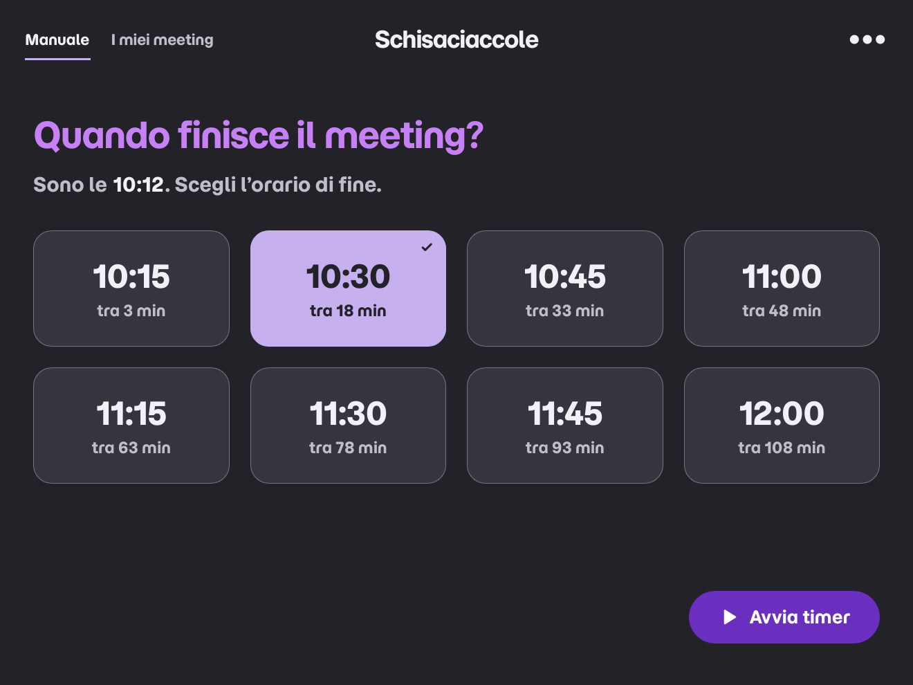
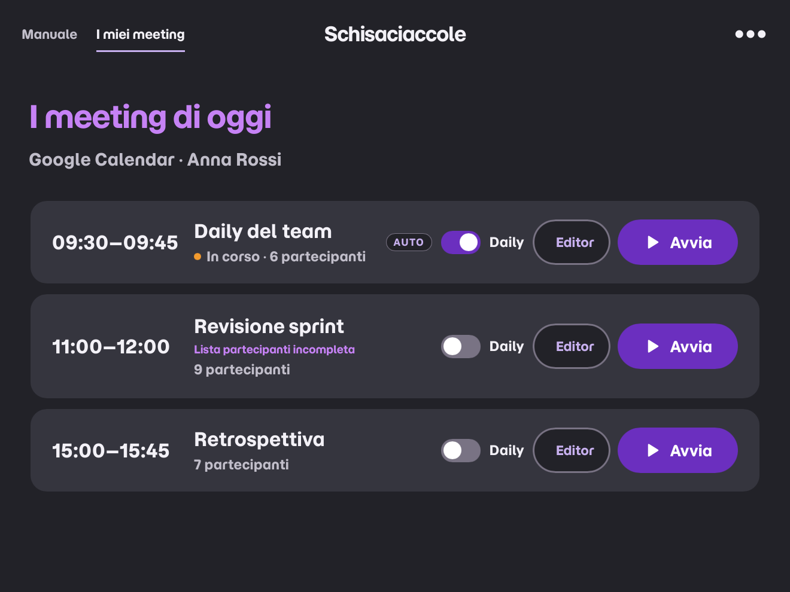
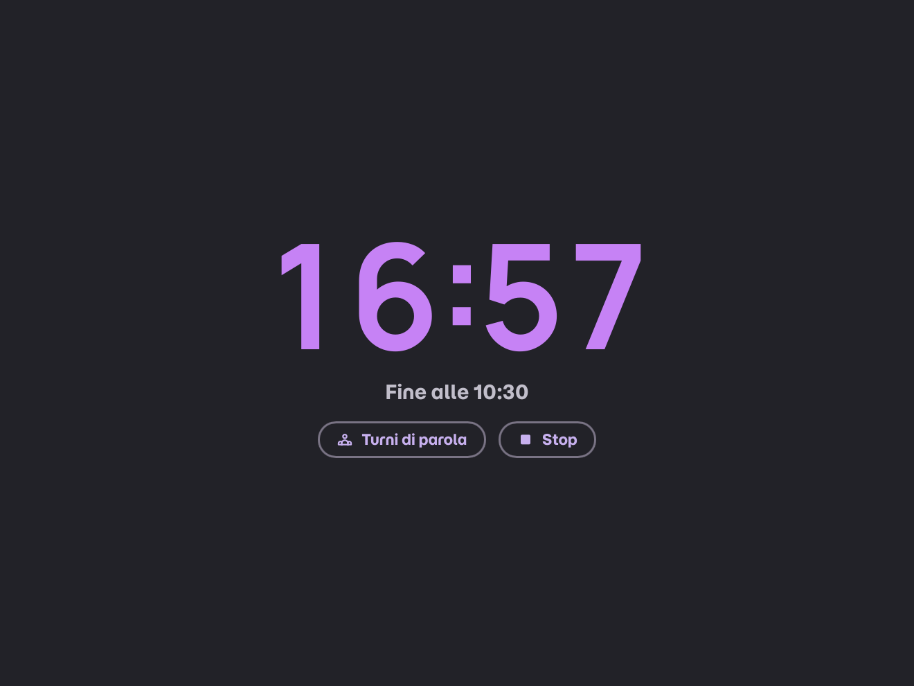
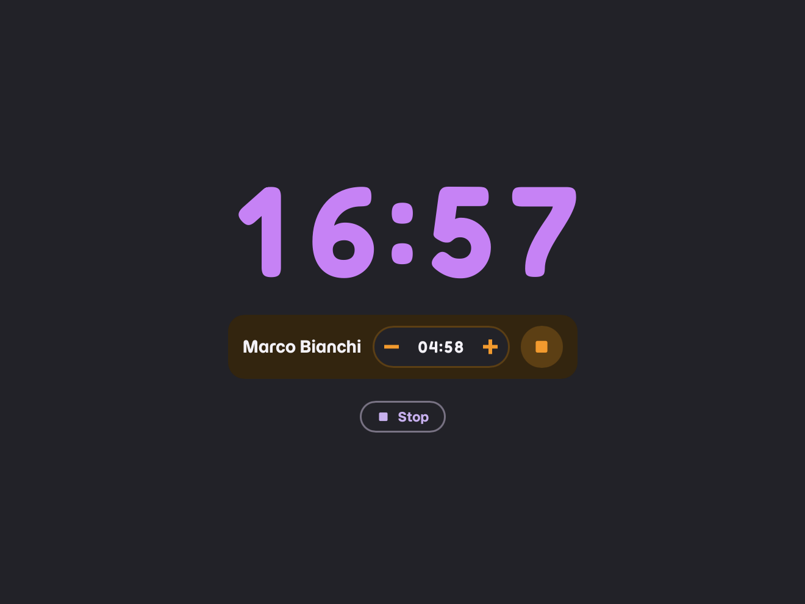
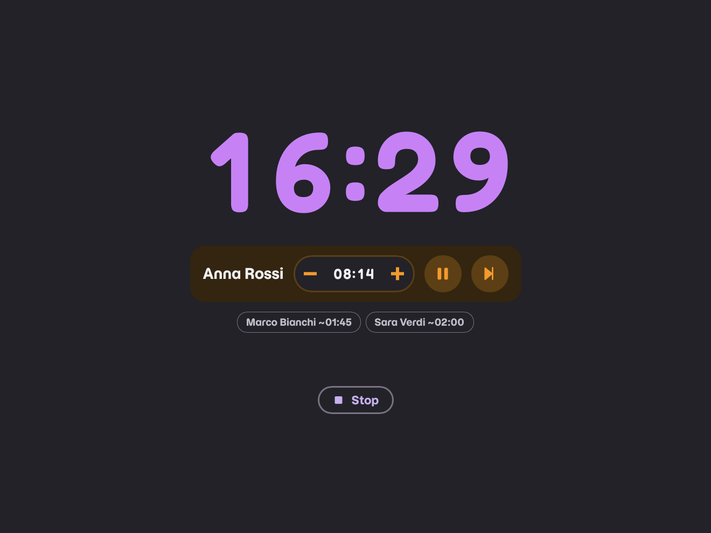
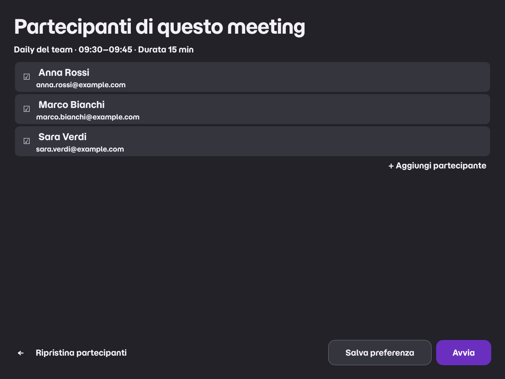
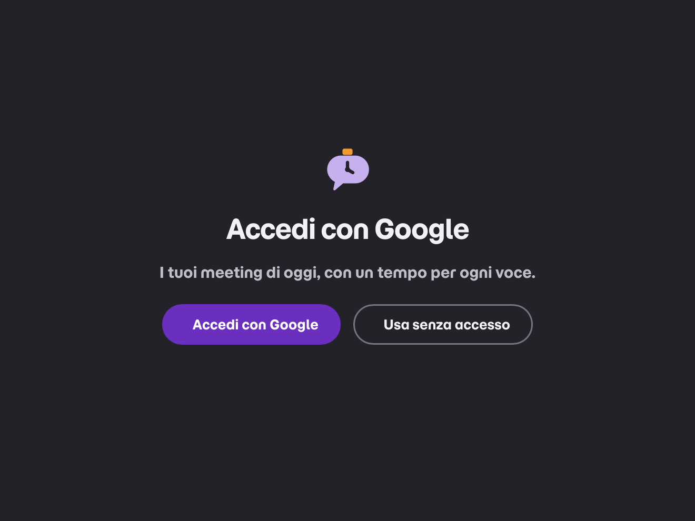
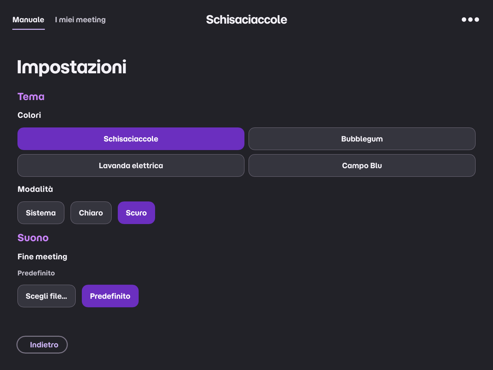

# Schisaciaccole

A countdown timer for **time-boxed Scrum ceremonies**.

Scrum ceremonies are time-boxed: regardless of when the team actually gets into
the meeting room, the meeting should end at its designated time. Schisaciaccole
makes that easy — instead of asking "how long do we have left?", you pick the
**wall-clock time the meeting must end** and the timer counts down precisely to
that moment.

## Features

- **Manual mode (`Manuale`)**: pick a quarter-hour end time and start the
  countdown. Works offline with no sign-in.
- **Today's meetings (`I miei meeting`)**: in backend-enabled builds, optional
  Google sign-in lists today's Google Calendar meetings, expanding invited
  Google Groups where accessible. Every countdown runs in a compact,
  always-on-top window.
- **Speaking turns (`Turni di parola`)**: assign timed turns to individual
  participants during a meeting countdown and adjust their time on the fly.
- **Daily mode (`Daily`)**: detected automatically for Daily/Stand-up meetings,
  or toggled per meeting. Shuffles participants and splits remaining time evenly
  among upcoming speakers, with pause, skip, and ±1 min adjustments.
- **Participant editor (`Editor`)**: include or exclude attendees for the current
  meeting, rename them, add people by hand, and optionally save renames and
  additions per meeting title.
- **Settings (`Impostazioni`)**: open the `⋯` menu to pick a custom
  end-of-meeting sound or adjust the app's appearance.

## Screenshots

| Manual mode | Today's meetings |
| --- | --- |
|  |  |

| Meeting timer | Speaking turns |
| --- | --- |
|  |  |

| Daily mode | Participant editor |
| --- | --- |
|  |  |

| Google sign-in | Settings |
| --- | --- |
|  |  |

## Keyboard shortcuts

| Key | Action |
| --- | --- |
| `Q` | Quit the app |
| `M` | Toggle fullscreen |
| `Esc` | Exit fullscreen |
| `T` | Toggle always on top |
| `H` | Show keyboard shortcuts |

On macOS, `Ctrl+T` also toggles **Always on top** from the **Window** menu.

## Install & run

Download a prebuilt release for Linux (`.deb`, Arch `.pkg.tar.zst`) or macOS
(`.dmg`/`.zip`) from [GitHub Releases](https://github.com/JustCris654/Schisaciaccole/releases).

Or run the local timer (Manual mode) from source with
[Rust](https://www.rust-lang.org/tools/install):

```sh
cargo run --release -p schisaciaccole
```

Google sign-in and Calendar features require a backend-enabled build; see the
[backend setup guide](docs/guide/setup-backend.md).

## License

[PolyForm Noncommercial License 1.0.0](LICENSE). Noncommercial use only;
commercial use requires the author's written permission.
Copyright (c) 2026 Cristian Scapin.
Built with [Slint](https://slint.dev), under the Slint Royalty-free license 2.0.
