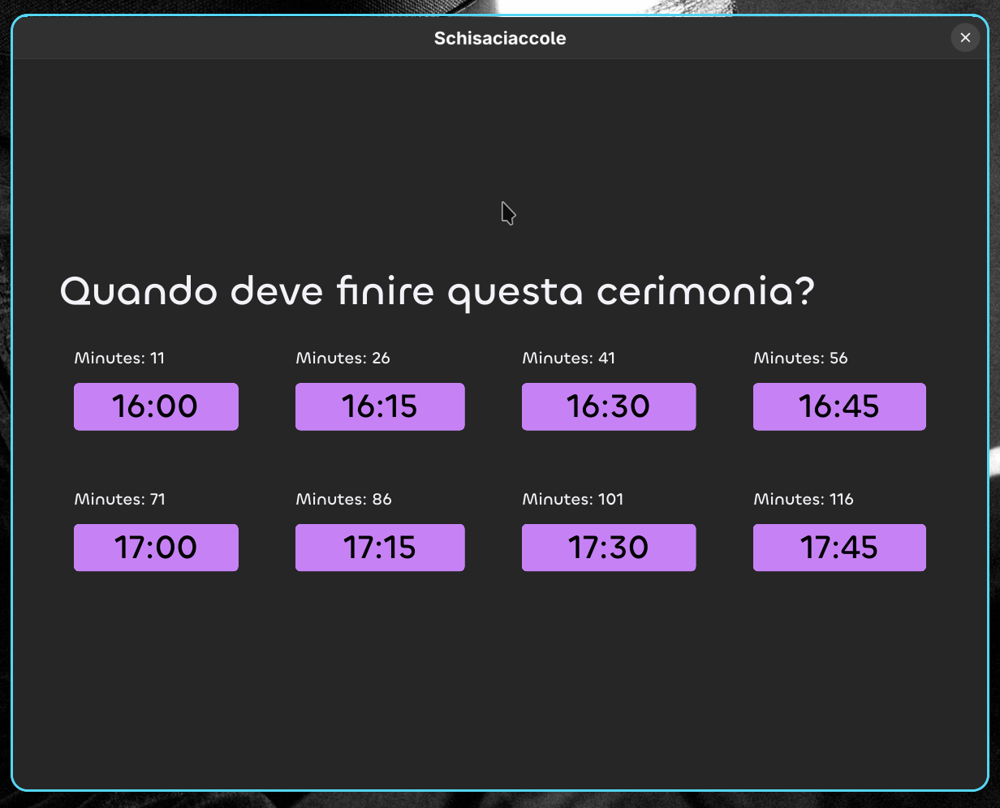
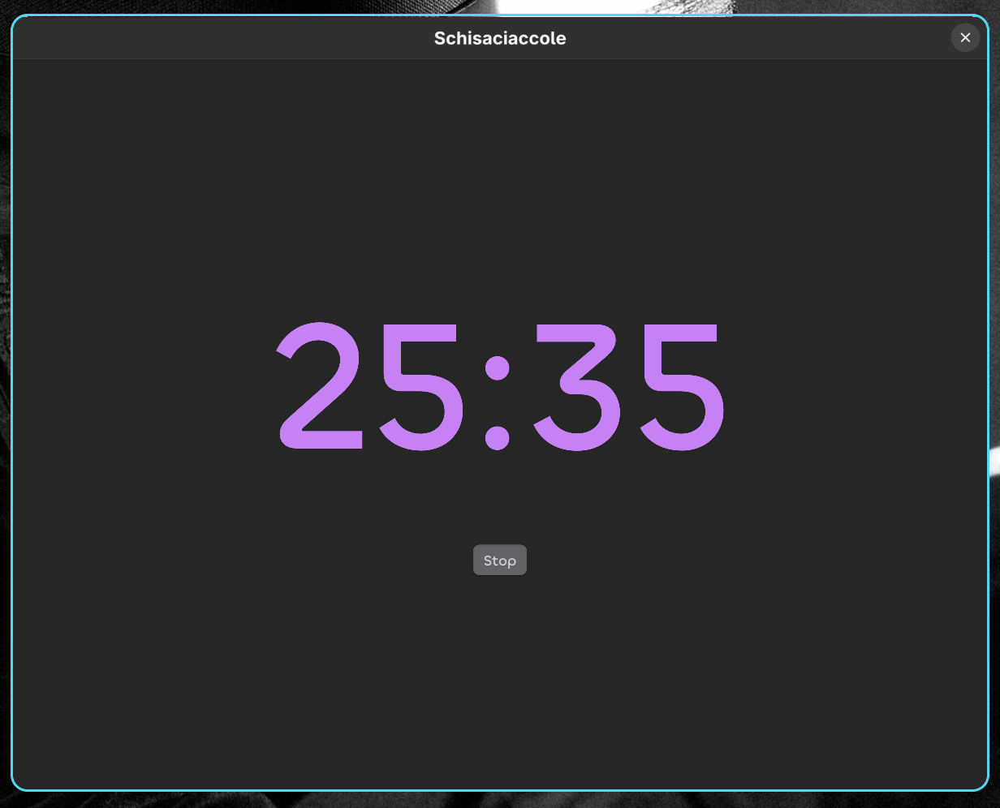

#+TITLE: Schisaciaccole

A countdown timer for *time-boxed Scrum ceremonies*.

Scrum ceremonies are time-boxed: regardless of when the team actually gets into
the meeting room, the meeting should end at its designated time. Schisaciaccole
makes that easy — instead of asking "how long do we have left?", you pick the
*wall-clock time the meeting must end* and the timer counts down precisely to
that moment.

* How it works

When you launch the app it shows the *next 8 quarter-hour marks* (00, 15, 30,
45 past the hour) starting from the upcoming quarter. That covers meetings of
up to *2 hours*.

- The options refresh automatically every 3 seconds, so they are always
  accurate even if the app sits open for a while before the meeting starts.
- Pick the slot when the ceremony has to end.
- The timer counts down to exactly that time and plays a sound when it
  reaches zero.
- Press *Stop* to end early and go back to the selection screen.

Example: it's 09:07 and the daily stand-up must wrap by 09:15. Open the app,
tap =09:15=, and the timer ends precisely at 09:15 — not 15 minutes from when
you pressed the button.

* Screenshots

| Selection                                           | Timer                                           |
|-----------------------------------------------------+-------------------------------------------------|
|  |  |

* Requirements

- [[https://www.rust-lang.org/tools/install][Rust]] (stable toolchain, =cargo=)

The font (*Plus Jakarta Sans*, under
=crates/app/assets/fonts/Plus_Jakarta_Sans/=) is embedded in the binary at
build time — no extra setup needed.

* Project layout

The repo is a Cargo workspace:

- =crates/app= — the =schisaciaccole= binary: Slint UI (=ui/=), =build.rs=,
  assets (=assets/=: icons, sound, font) and the bundle metadata.
- =crates/core= — the =schisaciaccole-core= library.

* Build & run

#+begin_src sh
cargo run -p schisaciaccole
#+end_src

For a release build:

#+begin_src sh
cargo run -p schisaciaccole --release
#+end_src

Tests and the checks CI runs on every push and pull request:

#+begin_src sh
cargo test --workspace
cargo clippy --workspace --all-targets -- -D warnings
cargo fmt --all --check
#+end_src

* Packaging

The app icons live at =crates/app/assets/icon_{128,256,512}.png= and the
=crates/app/assets/level_up_no_copyright.mp3= sound ships as a resource. At
runtime the sound is located relative to the executable, so it works from
every package layout (dev, deb, macOS app, Arch pkg).

** Linux (.deb) and macOS (.app) — cargo-bundle

Run cargo-bundle from the app crate, not from the workspace root: with
=cargo bundle -p schisaciaccole= at the root it resolves the icon and resource
paths against the current directory and silently leaves them out of the
bundle.

#+begin_src sh
cargo install --locked cargo-bundle   # once

cd crates/app
cargo bundle --release --format deb   # Linux  -> target/release/bundle/deb/*.deb
cargo bundle --release --format osx   # macOS  -> *.app (must run on macOS)
#+end_src

The bundles land in the workspace =target/= dir at the repo root. Bundle
metadata (name, identifier, icon, bundled resources) lives in the
=[package.metadata.bundle]= section of =crates/app/Cargo.toml=.

** Linux (.deb) via Docker

Building the =.deb= directly needs =cargo-bundle= plus a handful of native
dev libraries (ALSA, fontconfig, xcb...). =Dockerfile.deb= sets up a
throwaway Ubuntu 22.04 image with Rust, =cargo-bundle= and those libraries
pre-installed, so you don't need any of that on the host.

Build the image once:

#+begin_src sh
docker build -t deb-builder -f Dockerfile.deb .
#+end_src

Then run the bundle build, mounting the repo into the container:

#+begin_src sh
docker run --rm \
    --user $(id -u):$(id -g) \
    -e HOME=/tmp \
    -e CARGO_HOME=/tmp/cargo \
    -v "$(pwd)":/app \
    -w /app/crates/app \
    deb-builder cargo bundle --release --format deb
#+end_src

- =--user $(id -u):$(id -g)= makes the container write files as your host
  user instead of root.
- =HOME= and =CARGO_HOME= are redirected to =/tmp= because the mounted-in
  user has no home directory inside the container.

The resulting package lands at =target/release/bundle/deb/*.deb=, same as
the native =cargo bundle= build.

** Arch Linux (pacman)

#+begin_quote
*Run =makepkg= from inside =packaging/arch/=, never from the repo root.*
makepkg uses =./src= and =./pkg= as its work dirs and the PKGBUILD finds the
repo two levels above its own directory. It builds a clean copy of the
workspace (=Cargo.toml=, =Cargo.lock=, =crates/=) under its own =src/=, so
the sources are never touched.
#+end_quote

#+begin_src sh
cd packaging/arch
makepkg -f                  # rustup users without the pacman 'cargo' pkg: makepkg -fd
sudo pacman -U schisaciaccole-*.pkg.tar.zst
#+end_src

This installs the binary, the sound, the icon, a =.desktop= launcher and the
license under the standard =/usr= paths.

** Releases (CI)

Pushing a tag =vX.Y.Z= that matches the =version= in the
=[workspace.package]= section of the root =Cargo.toml= triggers
=.github/workflows/release.yml=, which builds the =.deb=, the Arch package
and an unsigned macOS =.app= (as a =.zip= and a =.dmg=) and attaches them all
to a GitHub Release:

#+begin_src sh
git tag v0.2.0
git push origin v0.2.0
#+end_src

A mismatched tag (e.g. tagging =v0.2.1= while =Cargo.toml= says =0.2.0=)
fails the run before anything is built. The workflow can also be triggered
manually (=workflow_dispatch=) to build and upload all three packages as
run artifacts without cutting a release.

* Logging

The app uses =env_logger=. Control verbosity with the =RUST_LOG= environment
variable (default is =warn=):

#+begin_src sh
RUST_LOG=info cargo run -p schisaciaccole     # callback events: selection, start/pause, stop, sound
RUST_LOG=debug cargo run -p schisaciaccole    # also the periodic option refresh
#+end_src

* License

Schisaciaccole is released under the
[[https://polyformproject.org/licenses/noncommercial/1.0.0][PolyForm Noncommercial License 1.0.0]]
(see =LICENSE=). Noncommercial use only: commercial use requires the author's
written permission. Copyright (c) 2026 Cristian Scapin.

The UI is built with [[https://slint.dev][Slint]], used under the Slint Royalty-free license 2.0.
