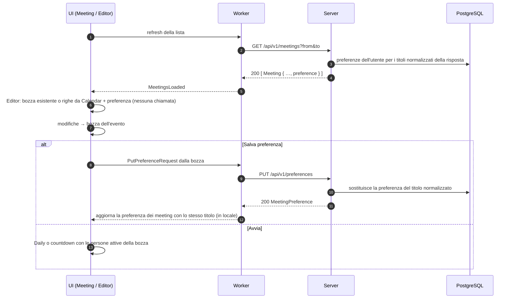

# Preferenze dei meeting senza pesi, editor locale

## Problema

Oggi la schermata **I miei meeting** legge i meeting con `GET /api/v1/meetings`; aprendo l'**Editor** l'app chiede di nuovo l'evento, i partecipanti e il piano con `GET /api/v1/meetings/{event_id}/plan`. Il server rilegge Calendar, ririsolve i gruppi e costruisce un piano pesato dal template salvato. L'editor resta in "Caricamento…" fino alla risposta.

Il modello dati salva ancora un peso per persona (`slot_template_entries.weight_secs`), più una voce `free_time`. I pesi non servono più: il tempo di ogni partecipante si decide durante il meeting (turni di parola, Daily). Inoltre il template salva gli invitati esclusi (peso 0), quindi un'assenza di un giorno diventa permanente.

Altri problemi del flusso attuale:

- **Avvia** dalla lista ignora il template: usa solo gli invitati di Calendar.
- **Avvia** dall'editor non parte mai in modalità Daily, anche con l'interruttore acceso.
- Le modifiche fatte nell'editor si perdono con **←**.

## Obiettivi

1. Tutti i dati arrivano con la lista: `GET /api/v1/meetings` porta anche la preferenza salvata di ogni meeting. Aprire l'editor è un passaggio solo locale, senza chiamate di rete.
2. La preferenza salva solo le **persone aggiunte** e le **rinomine degli invitati**. Disattivare una persona (invitata o aggiunta) è sempre temporaneo e non viene mai salvato.
3. Le modifiche non salvate dell'editor restano in memoria per quell'evento finché l'app è aperta, e valgono sia per **Avvia** dall'editor sia per **Avvia** dalla lista.
4. **Avvia** dall'editor segue l'interruttore Daily della riga: acceso, parte la Daily con le persone attive dell'editor.
5. Niente pesi nel modello dati, nelle API e nel core.

## Fuori dallo scopo

- Mostrare l'interruttore Daily nell'editor: resta solo sulla riga della lista (decisione del 2026-11-14).
- Compatibilità con client o server della versione precedente: app e server si rilasciano insieme (vedi [Compatibilità](#compatibilità)).
- Conservare i template già salvati: la migrazione li cancella.

## Comportamento per l'utente

### I miei meeting

- La lista si carica come oggi (all'apertura, ogni 60 secondi, tab, Ricollega Google).
- Il numero di partecipanti di una riga conta le persone che **Avvia** userebbe: invitati attivi più persone aggiunte attive, dalla bozza dell'evento se esiste, altrimenti da Calendar più preferenza salvata.
- **Avvia**: come oggi (Daily se l'interruttore è acceso e c'è almeno una persona, altrimenti countdown con turni di parola), ma con le persone della bozza o, senza bozza, invitati di Calendar più persone aggiunte salvate, con le rinomine salvate.
- **Editor**: apre subito l'editor, senza caricamento.

### Editor

Righe all'apertura:

- se l'evento ha già una bozza in memoria, la bozza;
- altrimenti gli invitati non rifiutati di Calendar (tutti attivi, con il nome rinominato se la preferenza ne ha uno per quell'email), poi le persone aggiunte della preferenza (tutte attive), nell'ordine salvato.

Ogni modifica aggiorna subito la bozza dell'evento.

| Azione | Effetto | Salvato con "Salva preferenza" |
| --- | --- | --- |
| Casella su un invitato | attiva o disattiva per questa volta | no |
| Casella su una persona aggiunta (nuova) | attiva o disattiva per questa volta | no (la persona sì) |
| Rinomina un invitato | nome mostrato nel timer | sì, se diverso dal nome di Calendar |
| Rinomina una persona aggiunta | nome mostrato nel timer | sì |
| **+ Aggiungi partecipante** | nuova riga attiva | sì, se ha un nome |
| **×** su una persona aggiunta | toglie la riga | sì (non c'è più) |
| **Ripristina partecipanti** | rifà le righe da Calendar più preferenza salvata, come se l'editor non fosse mai stato aperto | no |

Pulsanti:

- **Salva preferenza**: `PUT /api/v1/preferences` con le persone aggiunte (attive o no, con un nome) e le rinomine degli invitati. Durante l'invio "Salvataggio…", pulsanti disattivati. Poi "Preferenza salvata", oppure "Preferenza non valida" (400) o "Salvataggio non riuscito". La bozza resta com'è: le disattivazioni temporanee rimangono. Se non c'è niente da salvare (nessuna aggiunta, nessuna rinomina) e una preferenza esiste, l'app la elimina come **Elimina preferenza**; se non esiste, mostra "Niente da salvare" senza chiamate.
- **Elimina preferenza** (visibile solo se la preferenza esiste): `DELETE /api/v1/preferences/{id}`. Poi "Preferenza eliminata" (anche con 404) e righe riportate ai soli invitati di Calendar, tutti attivi.
- **Avvia**: se il meeting è finito resta sull'editor con "Il meeting è già terminato". Altrimenti, con l'interruttore Daily della riga acceso e almeno una persona attiva con un nome, parte la Daily in ordine casuale con quelle persone; in tutti gli altri casi countdown con turni di parola offerti alle stesse persone.
- Il pulsante **Avvia** si chiama "Avvia Daily" quando l'interruttore Daily della riga è acceso (l'interruttore non compare nell'editor).
- **←**: torna alla lista. La bozza resta.

La pagina non ha più lo stato "Caricamento…" né l'avviso "Preferenza non caricata: partecipanti del calendario".

### Durata della bozza

- Una bozza per `event_id`, creata alla prima apertura dell'editor su quell'evento.
- Resta finché l'app è aperta. Viene tolta quando l'evento non compare più nella lista (come le scelte Daily), al logout e alla perdita della sessione.
- Segue Calendar: a ogni ricarica della lista la bozza viene unita agli invitati appena letti (regole sotto). Le modifiche dell'utente restano.
- **Ripristina partecipanti** butta la bozza e la rifà da Calendar più preferenza salvata.

Unione della bozza con gli invitati appena letti (confronto delle email con trim e minuscole ASCII):

- un invitato già nella bozza resta con la sua casella e la sua etichetta;
- un nuovo invitato (anche chi ha tolto il rifiuto) entra attivo, con la rinomina della preferenza se c'è, altrimenti col nome di Calendar;
- un invitato che non c'è più (tolto dall'invito o che ha rifiutato) esce dalla bozza, anche se era rinominato;
- le righe degli invitati vengono riordinate come `participants` (per nome di Calendar), poi le persone aggiunte restano nel loro ordine, senza cambiamenti;
- la preferenza salvata non viene riapplicata: una preferenza cambiata da un altro dispositivo entra solo con **Ripristina partecipanti** o con un evento senza bozza.

Esempio: la bozza ha Anna, Bruno (disattivato), Carla e Marco (aggiunto). Calendar ora invita Dario e non più Carla. Dopo la ricarica la bozza ha Anna, Bruno (disattivato), Dario (attivo) e Marco.
- Salvare la preferenza dall'editor di un evento non cambia le bozze degli altri eventi con lo stesso titolo.

### Gruppi Google

I gruppi vengono esplosi dal server in `GET /api/v1/meetings` come oggi (`groups::resolve_meetings`, cache dei risultati completi di 60 secondi). Il design non cambia l'espansione: cambia solo chi la usa.

- La lista è l'unica fonte dei partecipanti. Senza `/plan` l'editor non chiede più una seconda risoluzione: una chiamata in meno a Calendar e a Cloud Identity Groups per ogni apertura dell'editor.
- Gli invitati di un gruppo espanso sono persone come le altre: casella, rinomina (salvata per email del membro), conteggio, Daily e turni.
- Un gruppo non espanso (errore, permesso mancante, traversata incompleta) resta una sola riga con l'indirizzo del gruppo, come oggi, e la riga della lista e l'editor mostrano l'avviso di lista incompleta con **Ricollega Google**. Quella riga si può disattivare come le altre.
- Una rinomina dell'indirizzo del gruppo viene salvata per quell'email; quando il gruppo viene espanso la rinomina non si applica ma resta nella preferenza (regola delle rinomine conservate).

Lista incompleta e bozza. Un fallimento temporaneo dell'espansione cambierebbe gli invitati da "membri del gruppo" a "indirizzo del gruppo" e, alla ricarica dopo, di nuovo ai membri. Unendo la bozza ogni volta, l'utente perderebbe le disattivazioni dei membri. Per evitarlo la bozza ricorda se è stata creata o unita l'ultima volta con una lista completa (`participants_incomplete` falso: niente invitati omessi da Calendar, niente gruppi incompleti, niente consenso mancante):

| Bozza | Lista appena letta | Effetto |
| --- | --- | --- |
| completa | completa | unione normale |
| completa | incompleta | nessuna unione: la bozza resta com'è finché la lista torna completa |
| incompleta | incompleta | unione normale (la riga del gruppo resta) |
| incompleta | completa | unione normale: esce la riga del gruppo, entrano i membri attivi (il caso tipico dopo **Ricollega Google**) |

Durante una lista incompleta i cambi degli invitati diretti entrano alla prima ricarica completa. **Ripristina partecipanti** rifà comunque la bozza dai dati correnti, completi o no.

## Flusso



Dopo un salvataggio o un'eliminazione l'app aggiorna in locale la preferenza di tutti i meeting della lista con lo stesso titolo normalizzato e non ricarica la lista: la risposta del server basta.

## API

Rotte rimosse: `GET /api/v1/meetings/{event_id}/plan`, `PUT /api/v1/templates`, `DELETE /api/v1/templates/{id}`.

Rotte nuove:

| Metodo e percorso | Corpo | Risposta |
| --- | --- | --- |
| `PUT /api/v1/preferences` | `PutPreferenceRequest` | `200 MeetingPreference` |
| `DELETE /api/v1/preferences/{id}` | | `204`, oppure `404 not_found` se l'id non è un UUID, non esiste o è di un altro utente |

`GET /api/v1/meetings` resta com'è, ma ogni `Meeting` ha il campo `preference` al posto di `has_template`.

Tipi in `crates/core/src/api.rs`:

```rust
/// Kind of a person saved in a meeting preference.
pub enum PersonKind {
    /// A meeting attendee, identified by email: the entry renames them.
    Attendee,
    /// A person added by hand.
    Manual,
}

pub struct PreferencePerson {
    pub kind: PersonKind,
    /// `Some` only for `Attendee`.
    pub email: Option<String>,
    pub label: String,
}

pub struct PutPreferenceRequest {
    pub meeting_title: String,
    pub people: Vec<PreferencePerson>,
}

pub struct MeetingPreference {
    pub id: String,
    pub meeting_title: String,
    /// Attendee renames and manual people; manual people in saved order.
    pub people: Vec<PreferencePerson>,
}

pub struct Meeting {
    // campi attuali, senza has_template
    #[serde(default)]
    pub preference: Option<MeetingPreference>,
}
```

Esempio JSON di `PUT /api/v1/preferences`:

```json
{
  "meeting_title": "Daily SmartBIP",
  "people": [
    { "kind": "attendee", "email": "anna.rossi@azienda.it", "label": "Anna" },
    { "kind": "manual", "email": null, "label": "Marco (consulente)" }
  ]
}
```

Validazione di `PUT /api/v1/preferences` (400 `invalid_request` alla prima regola violata):

- titolo normalizzato non vuoto, titolo al massimo 500 caratteri (come oggi);
- da 1 a 100 persone (una preferenza vuota si elimina con `DELETE`);
- etichetta da 1 a 200 caratteri dopo il trim;
- `attendee` con email non vuota di al massimo 320 caratteri, `manual` senza email;
- la stessa email (trim, minuscole ASCII) al massimo una volta.

La preferenza resta legata al titolo normalizzato (`normalize_title`), come il template: vale per tutte le occorrenze di un meeting ricorrente e per meeting diversi con lo stesso titolo. L'upsert mantiene lo stesso id quando sostituisce una preferenza esistente.

## Modello dati

Migrazione `0003_meeting_preferences.sql`:

```sql
DROP TABLE slot_template_entries;
DROP TABLE slot_templates;

CREATE TABLE meeting_preferences (
  id            UUID PRIMARY KEY,
  user_id       UUID NOT NULL REFERENCES users(id) ON DELETE CASCADE,
  meeting_key   TEXT NOT NULL,
  meeting_title TEXT NOT NULL,
  updated_at    TIMESTAMPTZ NOT NULL DEFAULT now(),
  UNIQUE (user_id, meeting_key)
);

CREATE TABLE meeting_preference_people (
  preference_id  UUID NOT NULL REFERENCES meeting_preferences(id) ON DELETE CASCADE,
  position       INT  NOT NULL,
  kind           TEXT NOT NULL CHECK (kind IN ('attendee', 'manual')),
  attendee_email TEXT,
  label          TEXT NOT NULL,
  PRIMARY KEY (preference_id, position),
  CHECK ((kind = 'attendee') = (attendee_email IS NOT NULL))
);
```

- I template esistenti vengono cancellati (decisione del 2026-11-14): gli utenti rifanno le preferenze.
- Niente colonna peso né tipo `free_time`.
- L'unicità delle email è controllata dal server prima di scrivere; non serve un indice (le email arrivano già normalizzate per il confronto, non per la scrittura).
- `GET /api/v1/meetings` legge solo le preferenze dei titoli presenti nella risposta (`meeting_key = ANY($2)`), non tutte quelle dell'utente.

## Regole nel core

`crates/core/src/plan.rs` perde pesi e piani e diventa la logica delle righe dell'editor e della preferenza. Funzioni proposte (nomi indicativi):

- `editor_rows(participants, preference) -> Vec<EditorEntry>`: invitati non rifiutati in ordine di `participants` (per nome), con l'etichetta rinominata se la preferenza ha la loro email (confronto trim e minuscole ASCII), poi le persone `manual` nell'ordine salvato. Tutte attive. Una rinomina di un'email che non è tra gli invitati viene ignorata.
- `preference_people(rows, participants, saved) -> Vec<PreferencePerson>`:
  - per ogni invitato, una voce `attendee` solo se l'etichetta (trim) non è vuota ed è diversa dal nome che Calendar darebbe (`participants`, con `display_name_from_email` come ripiego); attivo o no non conta;
  - le rinomine salvate di email che oggi non sono tra gli invitati vengono conservate, così salvare da un'occorrenza con meno invitati non cancella le rinomine degli altri;
  - per ogni riga aggiunta con un nome, una voce `manual` (attiva o no);
  - righe aggiunte senza nome scartate.
- `merge_rows(rows, participants, preference) -> Vec<EditorEntry>`: unisce una bozza agli invitati appena letti con le regole di [Durata della bozza](#durata-della-bozza). La scelta se unire o no secondo la completezza della lista ([Gruppi Google](#gruppi-google)) sta nell'app, non qui. `preference` serve solo per il nome dei nuovi invitati. Senza cambi negli invitati restituisce le stesse righe.
- `start_names(rows) -> Vec<String>`: etichette (trim) delle righe attive non vuote, in ordine di riga. Oggi è un metodo di `ParticipantEditor`; può restare lì.
- `normalize_title` resta.

`EditorEntry` resta con `kind`, `email`, `label`, `included`; `kind` diventa `PersonKind`. Le righe `Manual` diventano disattivabili (`set_included` non le esclude più).

Rimossi dal core perché senza uso dopo la modifica: `build_plan`, `plan_to_editor`, `editor_to_template`, `FREE_TIME_LABEL`, `PARTICIPANT_WEIGHT_SECS`, `EntryKind`, `TemplateEntry`, `PutTemplateRequest`, `Template`, `PlanSource`, `PlanEntry`, `SlotPlan`, `meeting_plan_path`, `template_path`, `MEETING_PLAN_ROUTE`, `TEMPLATE_ROUTE`, `TEMPLATES_PATH`. Anche `allocate_ms`, `SlotSchedule`, `SlotView` e `MIN_SLOT_MS` in `slots.rs` (già oggi non usati da app e server); `participants` resta.

## App desktop

- `ParticipantEditor` non ha più `load_plan` né `template_id` proprio: si crea da `Meeting` (con la sua `preference`) o da una bozza esistente. La preferenza corrente si legge dal meeting della lista.
- `AppState` tiene `drafts: HashMap<String, Draft>` per `event_id` (`Draft` ha le righe e il flag `complete` della lista con cui è stata creata o unita l'ultima volta), potato in `on_meetings_loaded` come `daily_choices` e svuotato in `forget_meetings`. In `on_meetings_loaded` ogni bozza rimasta passa per `merge_rows` con il meeting appena letto, salvo il caso bozza completa e lista incompleta; se l'editor è aperto su quell'evento, la pagina mostra le righe unite.
- `open_editor` non restituisce più un `event_id` da caricare e non c'è stato `loading`. In `main.rs` sparisce `spawn_plan_fetch`.
- `select_meeting` e `start_from_editor` usano la stessa funzione per decidere Daily o countdown e per ottenere i nomi (bozza, altrimenti Calendar più preferenza).
- `backend.rs` e `session.rs`: tolto `fetch_plan`; `put_template` e `delete_template` diventano `put_preference` e `delete_preference`; il worker `plan` sparisce.
- Dopo un salvataggio o un'eliminazione riuscita, `AppState` aggiorna `preference` dei meeting con lo stesso titolo normalizzato e non chiede una nuova lettura della lista.
- Slint: casella anche sulle righe aggiunte (× resta), niente `editor-loading`, conteggio della riga dalla stessa funzione dei nomi di avvio. Testi da aggiungere: "Niente da salvare", "Avvia Daily".

## Server

- `meeting_plan.rs` rimosso; `templates.rs` diventa `preferences.rs` con `put_preference`, `delete_preference` e `validate_preference`.
- `store.rs`: `upsert_preference`, `delete_preference`, `preferences_by_keys(user_id, keys)`; spariscono `template_keys`, `template_by_key` e il codice dei pesi.
- `meetings.rs`: al posto di `has_template` riempie `preference` per ogni meeting dal risultato di `preferences_by_keys`.
- Le rotte nuove usano `AuthUser` come oggi; le query filtrano sempre per `user_id`.
- `.sqlx/` rigenerato con `cargo sqlx prepare --workspace`.
- Test: `tests/templates.rs` diventa `tests/preferences.rs`; i test del piano in `tests/meetings.rs` e `tests/groups.rs` vengono tolti o spostati sulla lista.

## Compatibilità

App e server vanno rilasciati insieme. Le combinazioni miste degradano senza rompere:

| Client | Server | Effetto |
| --- | --- | --- |
| vecchio | nuovo | l'editor riceve 404 dal piano e mostra i partecipanti del calendario con l'avviso; il salvataggio dà "Salvataggio non riuscito" |
| nuovo | vecchio | i meeting arrivano senza `preference` (default `None`) e l'editor funziona in locale; salvataggio ed eliminazione danno "… non riuscito" |

I template salvati prima della migrazione sono persi in ogni caso.

## Errori

| Errore | Lista | Editor: salva / elimina |
| --- | --- | --- |
| Nessun refresh token, refresh `401`, `401 google_reauth_required` | Login (come oggi) | Login (come oggi) |
| `400 invalid_request` | "Impossibile caricare i meeting." | "Preferenza non valida" / "Eliminazione non riuscita" |
| `404 not_found` | | elimina: trattato come successo |
| `429`, irraggiungibile, `5xx` | come oggi | "Salvataggio non riuscito" / "Eliminazione non riuscita" |

La colonna "Editor: piano" della guida sparisce.

## Documentazione da aggiornare con l'implementazione

- `docs/guide/flusso-frontend-backend.md` e la versione HTML: mappa di navigazione, schede 3.5 e 3.6, flussi 4.3, 4.4 (rimosso), 4.5, 4.6, rotte, tabella errori, diagramma architettura (tabelle PostgreSQL, worker).
- `docs/guide/panoramica.md` dove cita template e pesi.
- `README.md` dove cita template, piani o rotte.
- `.claude/rules/api.md`, `.claude/rules/desktop.md`, `.claude/rules/core.md` e le copie in `.agents/`: oggi dicono che il desktop non usa template e piani, già falso; vanno riscritte sulle preferenze.
- Team doc e glossari Rust secondo `.claude/rules/docs.md`.

