# Schisaciaccole: schermate del frontend e interazioni con il backend

Questo documento descrive tutte le schermate dell'app desktop (Slint, crate `schisaciaccole`) e come ognuna dialoga con il server (axum, crate `schisaciaccole-server`) per il login, la lettura dei meeting e il salvataggio delle preferenze dei meeting.

Indice:

1. [Mappa di navigazione](#1-mappa-di-navigazione)
2. [Architettura delle chiamate](#2-architettura-delle-chiamate)
3. [Schermate](#3-schermate)
4. [Flussi con il backend](#4-flussi-con-il-backend)
5. [Riferimento delle rotte](#5-riferimento-delle-rotte)
6. [Dagli errori del backend a quello che vede l'utente](#6-dagli-errori-del-backend-a-quello-che-vede-lutente)

Riferimenti nel codice: le pagine sono l'enum `Page` in `crates/app/ui/app-window.slint`, le transizioni stanno in `crates/app/src/state.rs`, le chiamate di rete in `crates/app/src/session.rs` (thread worker) e `crates/app/src/backend.rs` (client HTTP), le rotte in `crates/server/src/app.rs`.

---

## 1. Mappa di navigazione

Le schermate sono i rettangoli; i rombi sono decisioni prese dall'app; le etichette sulle frecce indicano l'azione dell'utente o la risposta del backend che causa il passaggio.

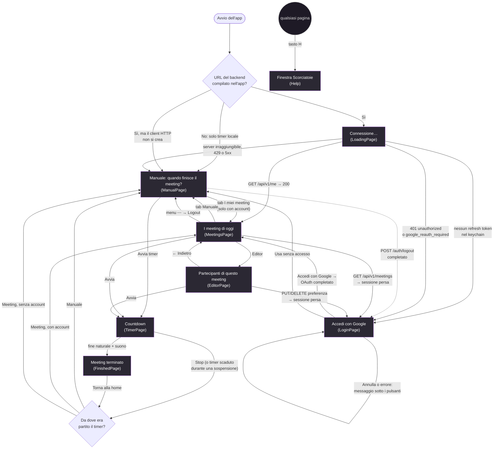

Note sulla mappa:

- Durante il timer la finestra si rimpicciolisce e va in primo piano; quando si torna a una pagina normale riprende dimensione e stato precedenti.
- Le tab Manuale e I miei meeting e il menu account esistono solo sulle pagine Manuale e Meeting. La tab I miei meeting è disattivata senza account.
- Su macOS il logout è anche nel menu Account della barra dei menu.
- La pagina di login fa anche da "Ricollega Google": il pulsante omonimo su Meeting ed Editor avvia lo stesso flusso OAuth senza cambiare pagina (vedi [4.2](#42-login-con-google-oauth--pkce)).

---

## 2. Architettura delle chiamate

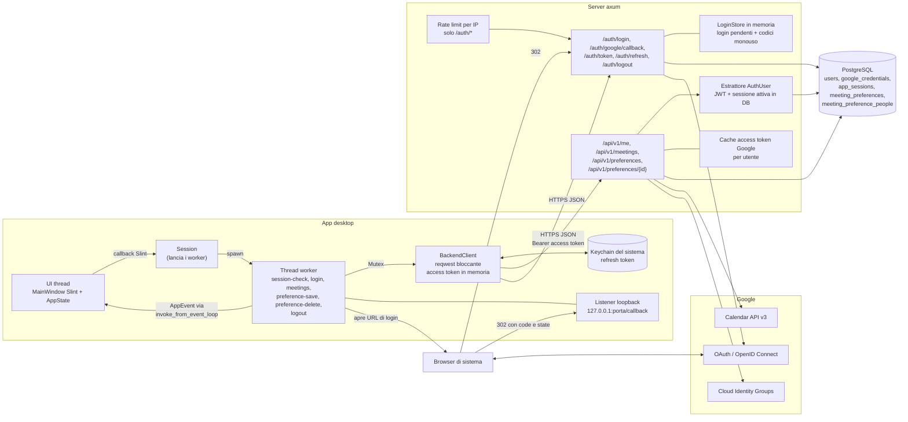

Come funziona il threading: lo stato della UI vive solo sul thread UI. Ogni chiamata di rete gira su un thread worker che usa il `BackendClient` condiviso e, alla fine, consegna un `AppEvent` al thread UI. Ogni tipo di richiesta ha un contatore: se l'utente ne lancia una nuova, il risultato di quella vecchia viene scartato all'arrivo. La UI non resta mai bloccata in attesa della rete.

Gestione dei token nell'app:

- Il refresh token (valido 90 giorni, ruota a ogni uso) è salvato nel keychain del sistema. Se il keychain non è disponibile resta solo in memoria e si perde alla chiusura.
- L'access token (JWT, 15 minuti) resta solo in memoria. Viene rinnovato con `POST /auth/refresh` se manca o scade entro 30 secondi, e una sola volta in più se una chiamata risponde 401 `unauthorized`.

---

## 3. Schermate

Ogni scheda riporta: cosa si vede, le azioni disponibili, le chiamate al backend e dove porta ogni azione. Le immagini sono gli screenshot in `assets/`; per le schermate senza screenshot c'è uno schema del layout.

### 3.1 Connessione (LoadingPage)

<table>
<tr>
<td width="40%" valign="top">
<pre>
┌──────────────────────────────┐
│                              │
│            [logo]            │
│         Connessione...       │
│   Prepariamo i tuoi meeting. │
│                              │
└──────────────────────────────┘
</pre>
</td>
<td valign="top">

**Quando appare:** all'avvio, solo se l'app è stata compilata con `SCHISACIACCOLE_BACKEND_URL` e il client HTTP è stato creato.

**Cosa fa:** un worker controlla la sessione salvata:

1. Se nel keychain non c'è un refresh token, va subito al Login (nessuna chiamata di rete).
2. Altrimenti `POST /auth/refresh` per avere un access token, poi `GET /api/v1/me`.

**Esiti:**

- `200` con `{ email, display_name }`: va su **I meeting di oggi**.
- `401 unauthorized`: va al **Login** senza messaggio.
- `401 google_reauth_required`: va al **Login** con "Concedi l'accesso al calendario e riprova.".
- Server irraggiungibile, `429`, `5xx`: va su **Manuale** con "Server non raggiungibile: modalità locale".

**Azioni utente:** nessuna.

</td>
</tr>
</table>

### 3.2 Accedi con Google (LoginPage)

<table>
<tr>
<td width="40%" valign="top">
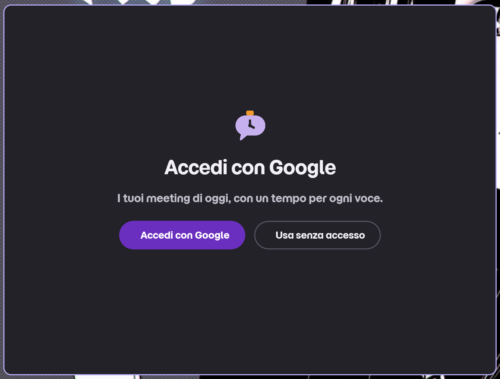
</td>
<td valign="top">

**Quando appare:** sessione assente o scaduta all'avvio, dopo il logout, o quando una chiamata API scopre che la sessione non vale più (il countdown in corso viene fermato).

**Azioni:**

- **Accedi con Google**: avvia il flusso OAuth con PKCE ([4.2](#42-login-con-google-oauth--pkce)). L'app apre il browser su `GET /auth/login`; la pagina mostra "Completa l'accesso nel browser…" e il solo pulsante **Annulla**.
- **Annulla**: interrompe l'attesa (il listener locale si chiude, l'eventuale risultato tardivo viene ignorato).
- **Usa senza accesso**: va su **Manuale** senza account e senza chiamate al backend.

**Esiti del login:**

- Successo: `POST /auth/token`, poi `GET /api/v1/me`, poi **I meeting di oggi**.
- Errori, mostrati sotto i pulsanti: "Usa il tuo account aziendale." (dominio non ammesso), "Concedi l'accesso al calendario e riprova.", "Troppi tentativi, riprova tra poco." (429), "Server non raggiungibile.", "Accesso non riuscito, riprova." (altro, incluso il timeout di 5 minuti).

</td>
</tr>
</table>

### 3.3 Pagine nel browser durante il login (esterne all'app)

<table>
<tr>
<td width="40%" valign="top">
<pre>
Browser
┌──────────────────────────────┐
│ 1. Consenso Google           │
│    (account, scope Calendar  │
│     e Groups)                │
├──────────────────────────────┤
│ 2. Pagina HTML del listener  │
│    locale dell'app:          │
│ "Accesso completato. Puoi    │
│  tornare a Schisaciaccole."  │
└──────────────────────────────┘
</pre>
</td>
<td valign="top">

**Consenso Google:** ci si arriva con il 302 di `GET /auth/login`. Google chiede gli scope `openid email profile`, Calendar (`calendar.events.owned.readonly`) e Cloud Identity Groups (`cloud-identity.groups.readonly`), limitati al dominio aziendale (`hd`).

**Ritorno:** Google rimanda a `GET /auth/google/callback` sul server, che a sua volta reindirizza a `http://127.0.0.1:<porta>/callback?code=…&state=…` (oppure `?error=…&state=…`). Il listener dell'app risponde con una piccola pagina HTML con l'esito.

**Login scaduto:** se lo `state` è sconosciuto, già usato o più vecchio di 10 minuti, il server non sa a quale porta tornare e mostra una pagina HTML 400 che chiede di riprovare dall'app.

</td>
</tr>
</table>

### 3.4 Manuale: "Quando finisce il meeting?" (ManualPage)

<table>
<tr>
<td width="40%" valign="top">
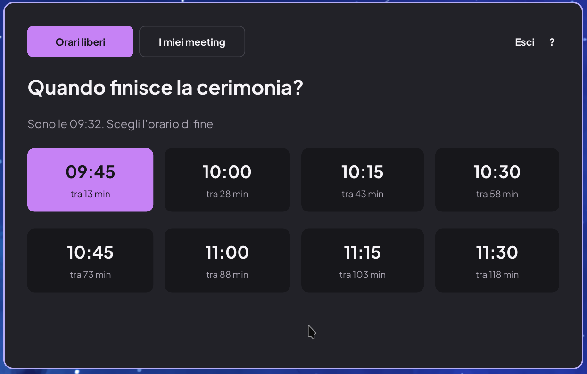
</td>
<td valign="top">

**Quando appare:** in modalità locale (app senza backend, server irraggiungibile, "Usa senza accesso", durante il logout) oppure dalla tab **Manuale**.

**Cosa si vede:** l'ora attuale e una griglia di orari di fine (quarti d'ora successivi) con i minuti rimanenti. Le opzioni si ricalcolano ogni 3 secondi quando nessun timer è attivo. Sotto può comparire un avviso: "Server non raggiungibile: modalità locale", "Accesso non disponibile: modalità locale" o "Disconnessione…".

**Azioni:**

- Selezionare un orario, poi **Avvia timer**: va al **Countdown** (origine manuale, senza turni di parola). Se l'orario scelto è già passato, le opzioni si aggiornano e il timer non parte.
- Tab **I miei meeting** (solo con account): va su **I meeting di oggi**.
- Menu **⋯ → Logout** (solo con account): vedi [4.6](#46-logout).

**Backend:** nessuna chiamata.

</td>
</tr>
</table>

### 3.5 I meeting di oggi (MeetingsPage)

<table>
<tr>
<td width="40%" valign="top">
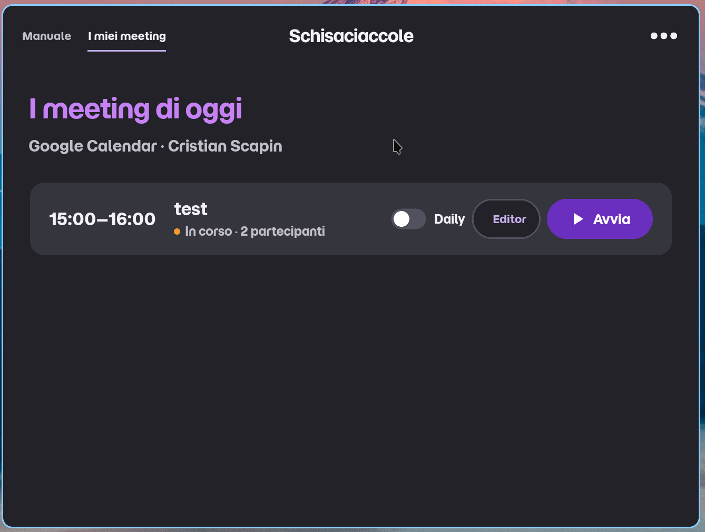
<br><sub>Lo screenshot è precedente al pulsante <b>Editor</b>, che oggi compare accanto ad <b>Avvia</b> in ogni riga.</sub>
</td>
<td valign="top">

**Quando appare:** dopo il login o il controllo della sessione, dalla tab **I miei meeting**, o al ritorno da Editor, Countdown e Meeting terminato con un account.

**Backend:** `GET /api/v1/meetings?from=<adesso>&to=<23:59:59.999 di oggi>` ([4.3](#43-lettura-dei-meeting)). Parte quando la pagina viene mostrata, ogni 60 secondi mentre resta aperta, e cliccando di nuovo sulla tab già attiva. Salvare o eliminare una preferenza dall'Editor non la rilancia: la lista aggiorna la preferenza in locale.

**Cosa si vede:** sottotitolo "Google Calendar · " seguito dal nome dell'account, poi una riga per meeting non ancora finito (prima quello in corso): orario, titolo, "In corso" o "Tra N min", numero di partecipanti: le persone che **Avvia** userebbe (chi ha rifiutato o è disattivato nell'Editor non è contato; le persone aggiunte a mano attive sì). Se la lista partecipanti è incompleta (Calendar ha omesso invitati o un gruppo Google non è stato espanso) la riga lo segnala. Se serve un nuovo consenso Google per leggere i gruppi compare il box "Autorizza Google Groups per leggere i membri. Calendar resta disponibile." con **Ricollega Google** (durante l'attesa del browser diventa **Annulla accesso**). Senza meeting: "Nessun altro meeting oggi.".

**Azioni:**

- **Interruttore Daily**: acceso in automatico (badge AUTO) se il titolo contiene `daily`, `standup`, `stand-up` o `scrum`. La scelta resta in memoria finché l'app è aperta e non va al backend.
- **Avvia**: va al **Countdown** fino alla fine del meeting. Con Daily acceso e almeno una persona parte la modalità Daily (ordine casuale); altrimenti countdown semplice con turni di parola offerti alle stesse persone. Le persone sono quelle della bozza dell'Editor, se il meeting ne ha una, altrimenti gli invitati del calendario più le persone e le rinomine della preferenza salvata.
- **Editor**: apre subito l'**Editor** del meeting, senza chiamate di rete.
- **Ricollega Google**: rifà il login OAuth restando sulla pagina; al termine ricarica i meeting.
- Tab **Manuale**, menu **⋯ → Logout**.

**Errori:** "Server non raggiungibile.", "Troppi tentativi, riprova tra poco.", "Impossibile caricare i meeting." (sopra la lista se c'erano già meeting, al suo posto altrimenti). Un 401 di sessione o `google_reauth_required` porta al **Login**.

</td>
</tr>
</table>

### 3.6 Partecipanti di questo meeting (EditorPage)

<table>
<tr>
<td width="40%" valign="top">
<pre>
┌────────────────────────────────────┐
│ Partecipanti di questo meeting     │
│ Sprint Review - 10:00-11:00 - 1h   │
│ (Lista partecipanti incompleta...) │
│ (Ricollega Google)                 │
│ ┌────────────────────────────────┐ │
│ │ [x] Anna Rossi                 │ │
│ │     anna@azienda.it            │ │
│ │ [ ] Bruno Verdi                │ │
│ │     bruno@azienda.it           │ │
│ │ [x] Marco                      │ │
│ │     Ospite esterno          x  │ │
│ └────────────────────────────────┘ │
│            + Aggiungi partecipante │
│ Preferenza salvata                 │
│ <-  Ripristina    Elimina  [Salva] │
│     partecipanti  preferenza       │
│                      [Avvia Daily] │
└────────────────────────────────────┘
</pre>
</td>
<td valign="top">

**Quando appare:** pulsante **Editor** su una riga di I meeting di oggi.

**All'apertura:** nessuna chiamata e nessun "Caricamento…". Tutti i dati sono già nella lista ([4.3](#43-lettura-dei-meeting)): ogni meeting porta la sua `preference`. Le righe sono:

- la bozza dell'evento, se esiste già in memoria;
- altrimenti gli invitati non rifiutati di Calendar (tutti attivi, con il nome rinominato se la preferenza ne ha uno per quell'email), poi le persone aggiunte della preferenza (tutte attive), nell'ordine salvato.

**Bozza:** ogni modifica aggiorna subito la bozza di quell'evento, che resta in memoria finché l'app è aperta: vale sia per **Avvia** dall'editor sia per **Avvia** dalla lista, e sopravvive a **←**. Viene tolta quando l'evento non compare più nella lista, al logout e alla perdita della sessione. Segue Calendar: a ogni ricarica della lista viene unita agli invitati appena letti (i nuovi entrano attivi, chi non è più invitato esce, le scelte dell'utente restano). Se la bozza era completa e la lista appena letta è incompleta (gruppo non espanso, invitati omessi, consenso mancante) non viene unita, così una espansione fallita per un momento non cancella le disattivazioni dei membri.

**Azioni locali (nessuna chiamata):**

- casella su qualsiasi riga, invitata o aggiunta: esclusione temporanea, mai salvata;
- rinominare una riga;
- **+ Aggiungi partecipante**: riga aggiunta a mano, massimo 99 righe;
- **×** per rimuovere una riga aggiunta a mano (gli invitati non si tolgono, si disattivano);
- **Ripristina partecipanti**: butta la bozza e rifà le righe da Calendar più preferenza salvata.

**Azioni con il backend:**

- **Salva preferenza**: `PUT /api/v1/preferences` ([4.4](#44-salvataggio-di-una-preferenza)). Salva solo le persone aggiunte (attive o no, con un nome) e le rinomine degli invitati; le caselle non vengono salvate. Durante l'invio: "Salvataggio…", pulsanti disattivati. Poi "Preferenza salvata", oppure "Preferenza non valida" (400) o "Salvataggio non riuscito". La bozza resta com'è. Senza niente da salvare e con una preferenza esistente la elimina come **Elimina preferenza**; senza preferenza mostra "Niente da salvare" e non chiama il server.
- **Elimina preferenza** (visibile solo se la preferenza esiste): `DELETE /api/v1/preferences/{id}` ([4.5](#45-eliminazione-di-una-preferenza)). "Eliminazione…", poi "Preferenza eliminata" (anche se era già sparita, 404) con le righe riportate ai soli invitati di Calendar, tutti attivi, oppure "Eliminazione non riuscita".
- **Ricollega Google**: come in I meeting di oggi.

Dopo un salvataggio o un'eliminazione riuscita la lista non viene riletta: l'app aggiorna la preferenza di tutti i meeting della lista con lo stesso titolo normalizzato.

**Navigazione:**

- **Avvia**: va al **Countdown** fino alla fine del meeting. Il pulsante si chiama **Avvia Daily** quando l'interruttore Daily della riga è acceso (l'interruttore compare solo nella lista). Con Daily acceso e almeno una persona attiva con un nome parte la Daily in ordine casuale; altrimenti countdown con turni di parola offerti alle stesse persone. Se il meeting è già finito resta sull'editor con "Il meeting è già terminato".
- **←**: torna a **I meeting di oggi**; la bozza resta, le risposte ancora in viaggio per l'editor vengono ignorate.
- Sessione persa durante salvataggio o eliminazione: **Login**.

</td>
</tr>
</table>

### 3.7 Countdown (TimerPage)

La stessa pagina ha quattro viste. La finestra diventa compatta e sempre in primo piano (puntino arancione in alto a destra). Il backend non viene mai chiamato.

<table>
<tr>
<td width="40%" valign="top">
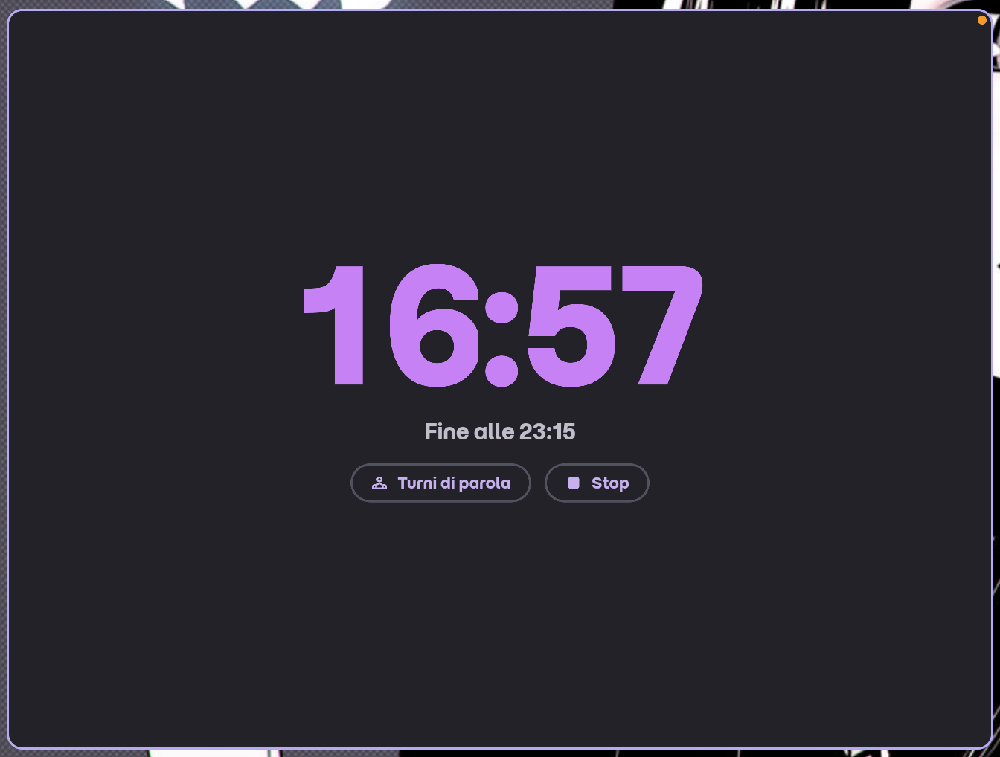
</td>
<td valign="top">

**Vista semplice:** tempo rimanente, "Fine alle HH:MM", **Stop**. Se il timer viene da un meeting con almeno un partecipante compare anche **Turni di parola**.

- **Stop**: torna alla pagina di origine (Manuale oppure I meeting di oggi).
- Arrivo a zero: suono di fine e pagina **Meeting terminato**.
- Se il computer era sospeso e la fine è passata da un pezzo, il timer si chiude senza suono, come uno Stop.

</td>
</tr>
<tr>
<td width="40%" valign="top">
<pre>
┌──────────────────────────────┐
│            16:57             │
│ [Anna v]  - 05 min +  [>]    │
│     [Nascondi]  [Stop]       │
└──────────────────────────────┘
</pre>
</td>
<td valign="top">

**Impostazione del turno** (da **Turni di parola**): si sceglie chi parla e quanti minuti (limitati al tempo che resta al meeting), poi si avvia il turno. **Nascondi** torna alla vista semplice.

</td>
</tr>
<tr>
<td width="40%" valign="top">
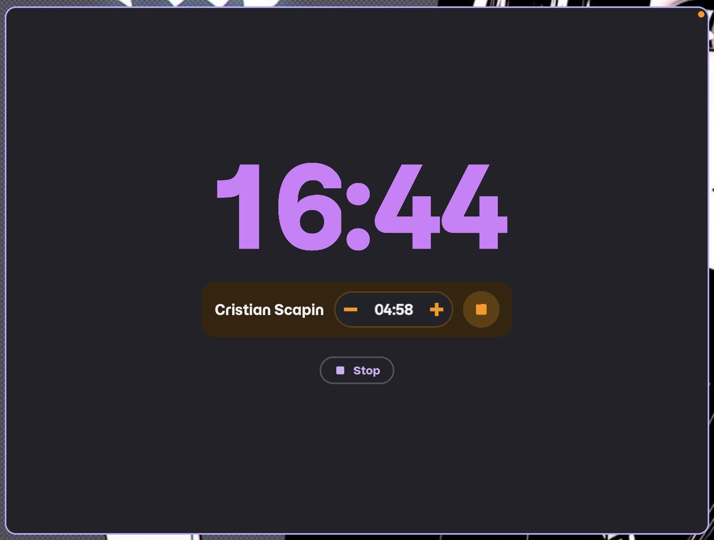
</td>
<td valign="top">

**Turno in corso:** nome di chi parla, tempo del turno con **−** e **+** per regolarlo, pulsante per chiudere il turno. A fine turno suona un beep.

</td>
</tr>
<tr>
<td width="40%" valign="top">
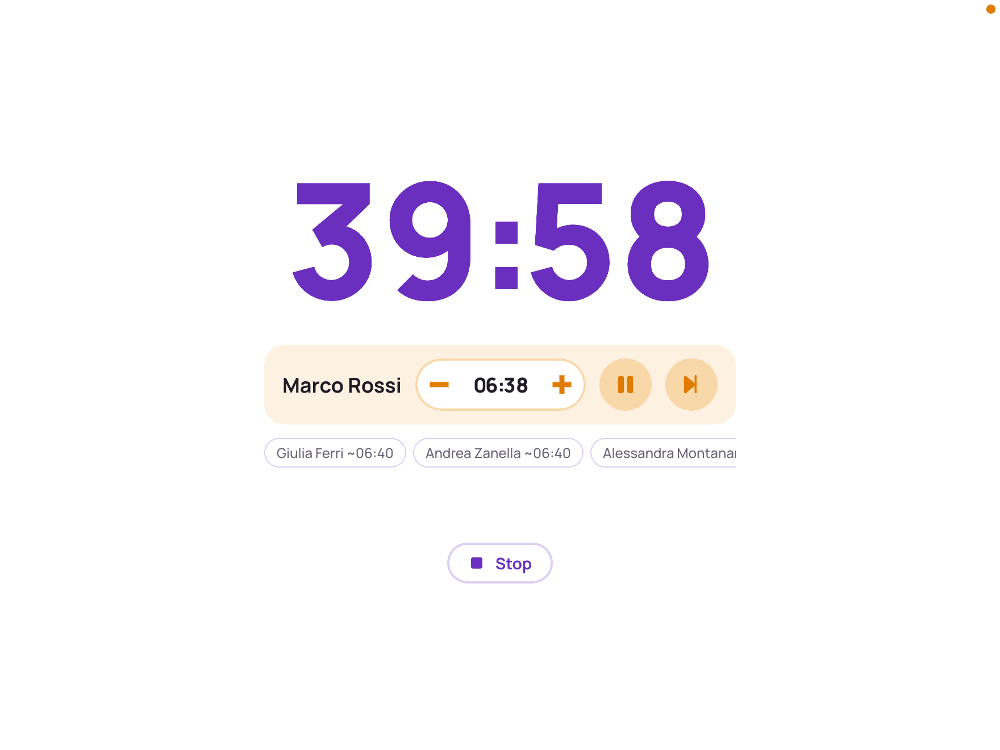
</td>
<td valign="top">

**Daily** (meeting avviato da I meeting di oggi con l'interruttore Daily acceso): partecipanti in ordine casuale, il tempo rimasto diviso tra chi non ha ancora parlato. Mostra chi parla con **−** e **+**, **pausa** (sospende il turno e mostra "IN PAUSA", il timer del meeting continua) e **prossimo**, più le chip dei prossimi con il tempo stimato. Alla fine: "Tutti hanno parlato".

</td>
</tr>
</table>

### 3.8 Meeting terminato (FinishedPage)

<table>
<tr>
<td width="40%" valign="top">
<pre>
┌──────────────────────────────┐
│   *  +   coriandoli   +  *   │
│                              │
│      Meeting terminato!      │
│                              │
│       [Torna alla home]      │
└──────────────────────────────┘
</pre>
</td>
<td valign="top">

**Quando appare:** il countdown arriva a zero (con il suono di fine).

**Cosa si vede:** animazione di coriandoli (ridotta se il sistema chiede meno movimento).

**Azioni:** **Torna alla home** porta alla pagina da cui era partito il timer: **Manuale**, oppure **I meeting di oggi** se c'è un account (senza account, **Manuale**).

**Backend:** nessuna chiamata. Tornando su I meeting di oggi la pagina ricarica i meeting.

</td>
</tr>
</table>

### 3.9 Scorciatoie da tastiera (finestra Help)

<table>
<tr>
<td width="40%" valign="top">
<pre>
┌──────────────────────────────┐
│ Scorciatoie da tastiera      │
│ [Q]   Esci dall'app          │
│ [M]   Schermo intero on/off  │
│ [Esc] Esci da schermo intero │
│ [T]   Finestra in primo piano│
│ [H]   Mostra le scorciatoie  │
└──────────────────────────────┘
</pre>
</td>
<td valign="top">

**Quando appare:** tasto **H** da qualsiasi pagina. È una finestra separata, sempre in primo piano.

**Le altre scorciatoie** funzionano su tutte le pagine della finestra principale: **Q** chiude l'app, **M** e **Esc** gestiscono lo schermo intero, **T** mette o toglie la finestra in primo piano.

**Backend:** nessuna chiamata.

</td>
</tr>
</table>

---

## 4. Flussi con il backend

### 4.1 Controllo della sessione all'avvio

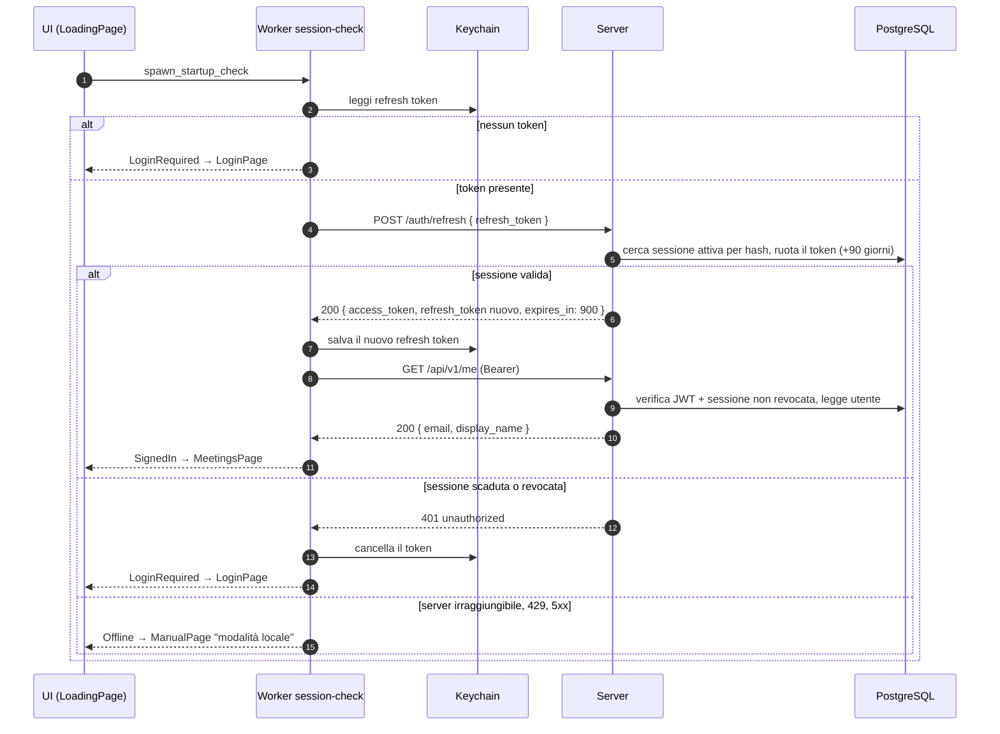

### 4.2 Login con Google (OAuth + PKCE)

Ci sono due PKCE: uno tra app e server (l'app genera `code_verifier` e invia solo la `code_challenge`), uno tra server e Google. Il server non passa mai i token Google all'app: le dà un codice monouso valido 60 secondi, da scambiare con la propria sessione.

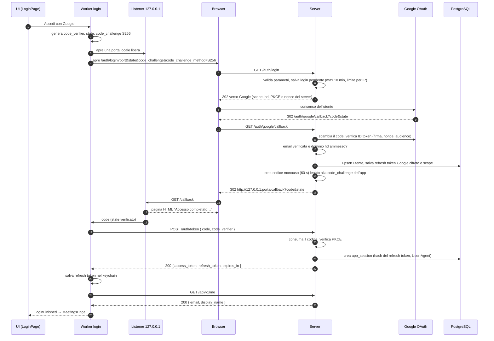

Casi di errore del login:

| Dove | Risposta | Messaggio nella LoginPage |
| --- | --- | --- |
| `GET /auth/login` | 429 (rate limit o troppi login dallo stesso IP) | La pagina di errore resta nel browser; l'app scade dopo 5 minuti con "Accesso non riuscito, riprova." |
| callback | `error=forbidden_domain` | "Usa il tuo account aziendale." |
| callback | `error=google_reauth_required` (Google non ha dato un refresh token e non ce n'è uno salvato) | "Concedi l'accesso al calendario e riprova." |
| callback | `error=invalid_code` o `internal` | "Accesso non riuscito, riprova." |
| `POST /auth/token` | 400 `invalid_code` (scaduto, già usato, PKCE errato) | "Accesso non riuscito, riprova." |
| `POST /auth/token` | 429 | "Troppi tentativi, riprova tra poco." |
| qualsiasi | server irraggiungibile | "Server non raggiungibile." |
| app | Annulla o 5 minuti senza risposta | Nessun messaggio (Annulla) o "Accesso non riuscito, riprova." |

Se il login parte da **Ricollega Google** con un account già attivo, al termine l'app ricarica subito i meeting.

### 4.3 Lettura dei meeting

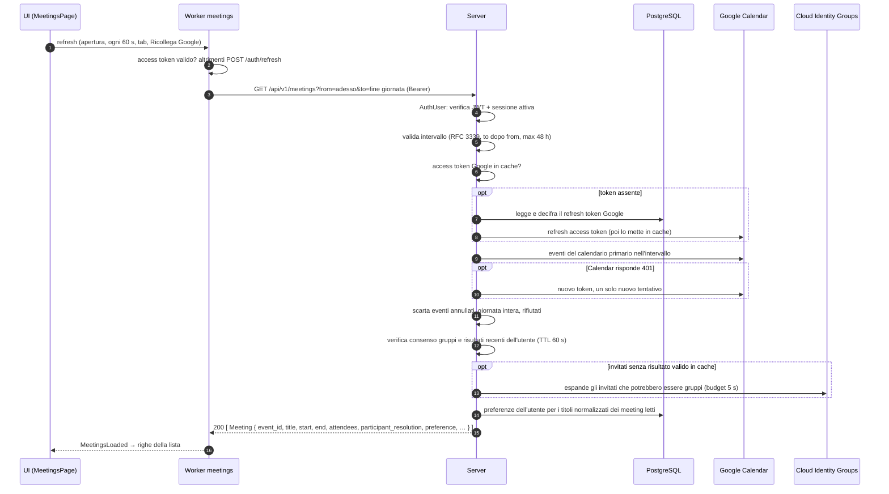

Note:

- Se l'utente non ha dato il consenso per i gruppi, i meeting arrivano lo stesso, con `participant_resolution.reauthorization_required = true`: l'app mostra l'avviso di lista incompleta e **Ricollega Google**.
- Il campo `preference` (`MeetingPreference { id, meeting_title, people }`, `null` se non c'è) porta le rinomine degli invitati e le persone aggiunte a mano, senza pesi. Il server legge solo le preferenze dei titoli presenti nella risposta, sempre filtrate per utente. L'app usa `preference` per le righe dell'Editor, per **Avvia** e per il conteggio dei partecipanti della riga.
- La lista è l'unica fonte dei partecipanti: l'Editor non rilegge l'evento e non risolve di nuovo i gruppi, quindi aprirlo non costa chiamate a Calendar né a Cloud Identity Groups.

La lista usa sul server una cache dei soli risultati completi dell'espansione dei gruppi,
compresi gli indirizzi confermati come invitati diretti: TTL 60 secondi, massimo
128 indirizzi per utente, 1.024 totali e 4 MiB di memoria conteggiata. Gli errori e
le espansioni parziali vengono ritentati alla richiesta successiva. Ogni richiesta
verifica i permessi correnti; credenziali diverse o un ricollegamento impediscono
il riuso dei vecchi risultati. L'evento Calendar e le preferenze vengono comunque
riletti: gli inviti e i metadati diretti aggiornati si applicano subito, mentre una
modifica ai membri di un gruppo può comparire entro 60 secondi.

### 4.4 Salvataggio di una preferenza

```mermaid
sequenceDiagram
    autonumber
    participant UI as UI (EditorPage)
    participant W as Worker preference-save
    participant S as Server
    participant DB as PostgreSQL

    UI->>UI: Salva preferenza → "Salvataggio…", pulsanti disattivati
    UI->>W: PutPreferenceRequest dalla bozza
    Note over UI,W: solo le persone aggiunte (attive o no, con un nome)<br/>e le rinomine degli invitati; le caselle non si salvano
    W->>S: PUT /api/v1/preferences { meeting_title, people[ kind, email, label ] }
    S->>S: valida (titolo, 1-100 persone, etichette 1-200 caratteri,<br/>email solo per gli invitati, stessa email una sola volta)
    alt valido
        S->>DB: upsert per (utente, titolo normalizzato), stesso id se esisteva
        S-->>W: 200 MeetingPreference { id, meeting_title, people }
        W-->>UI: "Preferenza salvata", aggiorna in locale i meeting con lo stesso titolo
    else non valido
        S-->>W: 400 invalid_request
        W-->>UI: "Preferenza non valida"
    else sessione persa
        S-->>W: 401
        W-->>UI: LoginPage
    end
```

La preferenza è legata al titolo normalizzato del meeting (stesse lettere senza distinguere maiuscole e spazi), non al singolo evento: vale per tutte le occorrenze di un meeting ricorrente e per meeting diversi con lo stesso titolo. Non c'è nessuna ricarica della lista: la risposta del server basta. Se l'utente salva senza persone aggiunte né rinomine e una preferenza esiste, l'app esegue invece l'eliminazione ([4.5](#45-eliminazione-di-una-preferenza)).

### 4.5 Eliminazione di una preferenza

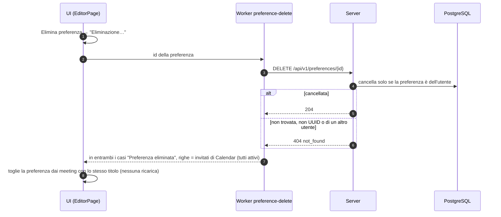

### 4.6 Logout

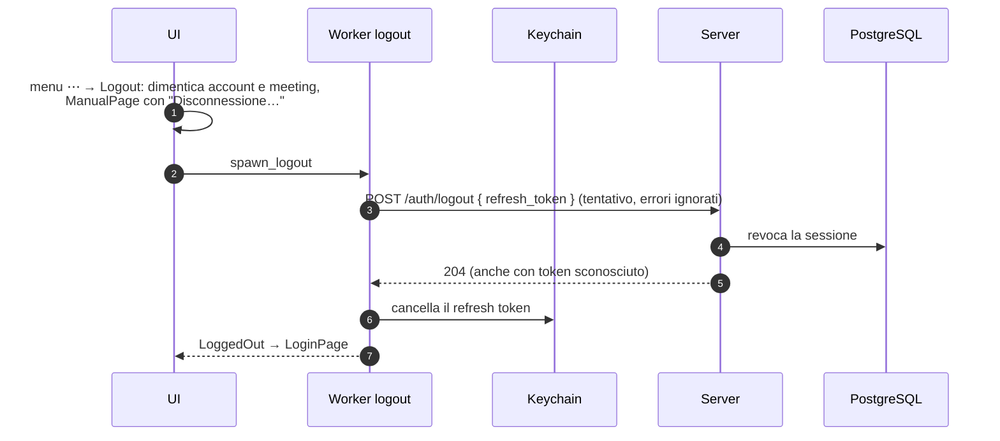

La revoca ha effetto subito: ogni chiamata `/api/v1/*` verifica nel database che la sessione del JWT sia ancora attiva.

### 4.7 Rinnovo dell'access token (per ogni chiamata `/api/v1/*`)

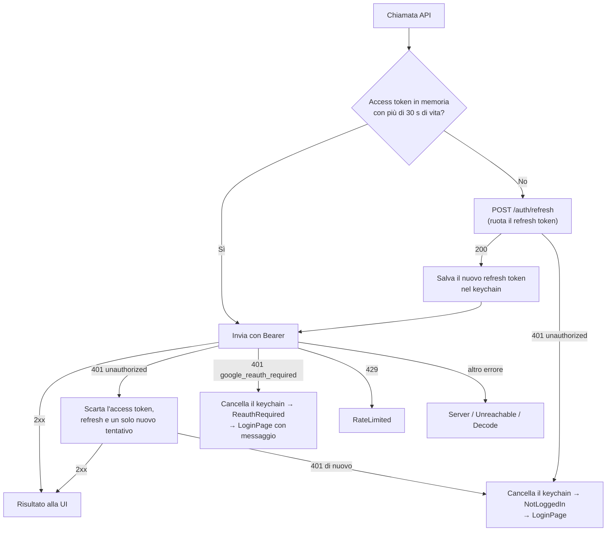

---

## 5. Riferimento delle rotte

| Metodo e percorso | Autenticazione | Chiamata da | Corpo / parametri | Risposta |
| --- | --- | --- | --- | --- |
| `GET /healthz` | nessuna | non usata dall'app | | `200 { status: "ok" }` |
| `GET /auth/login` | nessuna, rate limit per IP | browser, aperto da LoginPage o Ricollega Google | `port`, `state`, `code_challenge`, `code_challenge_method=S256` | `302` verso Google |
| `GET /auth/google/callback` | nessuna, rate limit per IP | browser, rimandato da Google | `code`, `state`, `error` | `302` al listener dell'app, o pagina HTML 400 |
| `POST /auth/token` | nessuna, rate limit per IP | worker login | `{ code, code_verifier }` | `200 TokenResponse` |
| `POST /auth/refresh` | refresh token nel corpo, rate limit per IP | qualsiasi worker, prima di una chiamata API | `{ refresh_token }` | `200 TokenResponse` (token ruotato) |
| `POST /auth/logout` | refresh token nel corpo, rate limit per IP | worker logout | `{ refresh_token }` | `204` |
| `GET /api/v1/me` | Bearer | LoadingPage, fine login | | `200 { email, display_name }` |
| `GET /api/v1/meetings` | Bearer | MeetingsPage | `from`, `to` RFC 3339, max 48 h | `200 [Meeting]` (ognuno con `preference`) |
| `PUT /api/v1/preferences` | Bearer | EditorPage, Salva preferenza | `{ meeting_title, people }` | `200 MeetingPreference` |
| `DELETE /api/v1/preferences/{id}` | Bearer | EditorPage, Elimina preferenza | `id` nel percorso | `204`, o `404 not_found` |

Rate limit di `/auth/*`: raffica di 10 richieste, poi una ogni 2 secondi per IP; oltre risponde `429` con `Retry-After`. Ogni richiesta ha un timeout di 30 secondi (`408`). Le risposte con token o dati utente hanno `Cache-Control: no-store`. Gli errori hanno il corpo `{ code, message }`, con `code` tra `unauthorized`, `google_reauth_required`, `invalid_request`, `invalid_code`, `forbidden_domain`, `not_found`, `too_many_requests`, `internal`.

---

## 6. Dagli errori del backend a quello che vede l'utente

| Errore | Avvio (LoadingPage) | I meeting di oggi | Editor: salva / elimina |
| --- | --- | --- | --- |
| Nessun refresh token, o refresh `401 unauthorized` | Login | Login | Login |
| `401 google_reauth_required` | Login con "Concedi l'accesso al calendario e riprova." | Login con lo stesso messaggio | Login con lo stesso messaggio |
| `400 invalid_request` | Manuale, modalità locale | "Impossibile caricare i meeting." | "Preferenza non valida" (salva) / "Eliminazione non riuscita" (elimina) |
| `404 not_found` | | | elimina: trattato come successo |
| `429` | Manuale, modalità locale | "Troppi tentativi, riprova tra poco." | "Salvataggio non riuscito" / "Eliminazione non riuscita" |
| Server irraggiungibile | Manuale, modalità locale | "Server non raggiungibile." | "Salvataggio non riuscito" / "Eliminazione non riuscita" |
| `5xx` o risposta illeggibile | Manuale, modalità locale | "Impossibile caricare i meeting." | "Salvataggio non riuscito" / "Eliminazione non riuscita" |

"Login" vuol dire che la sessione viene chiusa: l'eventuale countdown si ferma, account e meeting vengono dimenticati e si va alla LoginPage. Sulla lista dei meeting, se una lista era già caricata, il messaggio d'errore compare sopra senza cancellarla.
